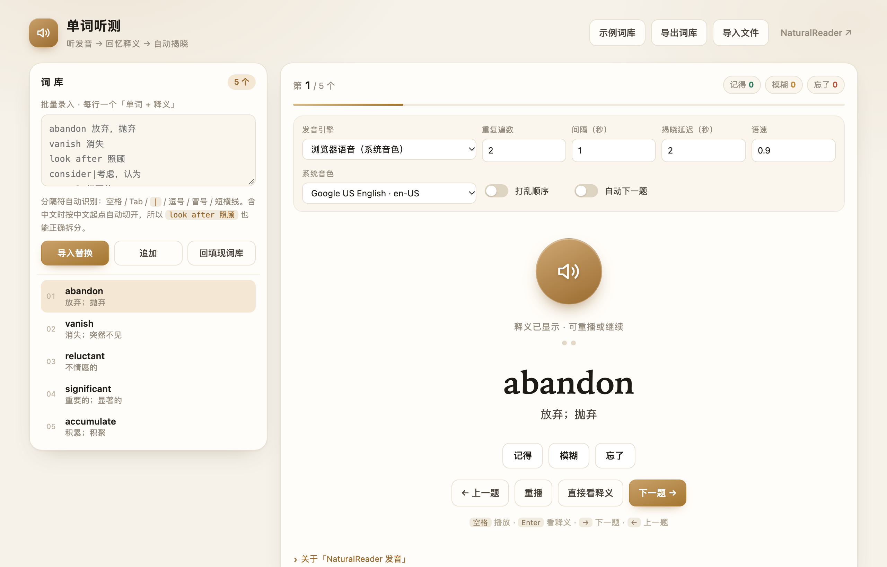
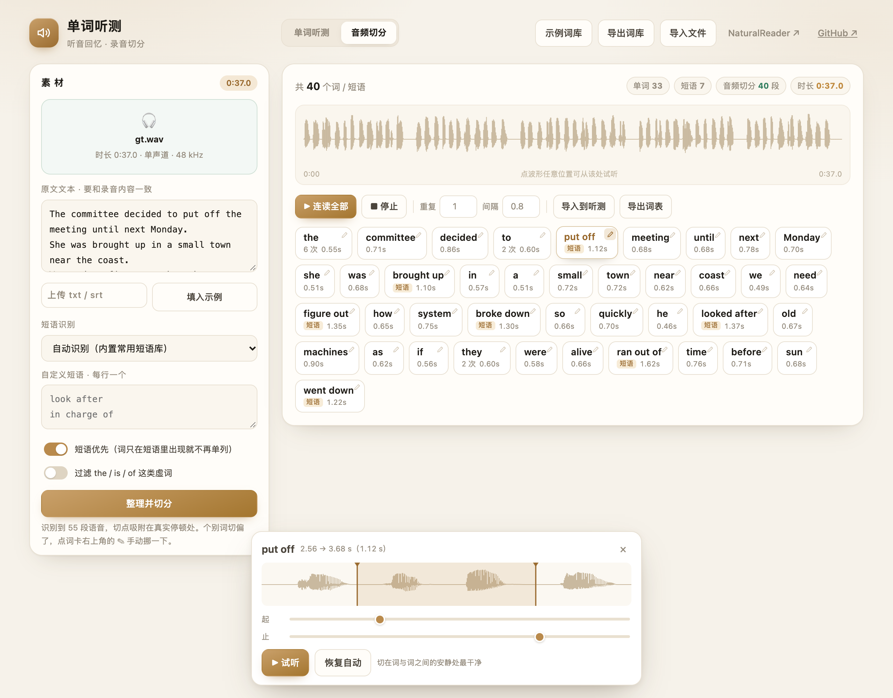
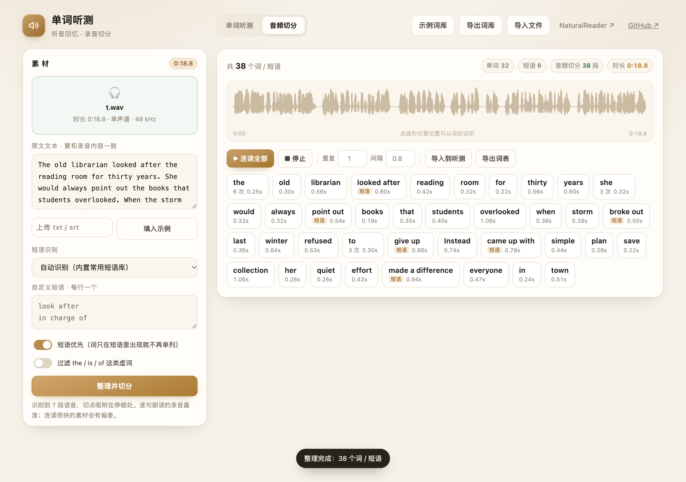
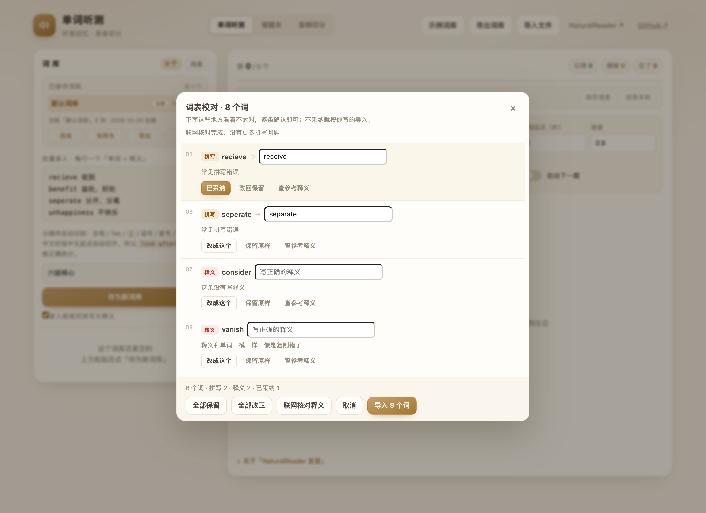

# 单词听测 · Word Listening Quiz

> **听发音 → 回忆释义 → 自动揭晓。**
> 一个单文件、零依赖、可离线使用的单词听测网页，外加一个「上传录音 + 原文就得到可点读词表」的音频切分工具。适合背单词、做听写、老师课堂带读、雅思托福备考。

[**▶ 在线使用（免安装）**](https://aprilplatanus.github.io/word-listening/) · [功能](#功能) · [词表格式](#词表格式) · [发音引擎](#发音引擎) · [本地使用](#本地使用)


## 它解决什么问题

传统背单词是「看着单词想意思」，考场上却是「听到单词想意思」。这个页面把顺序倒过来：
**只给声音，不给拼写**，让你在 2 秒的空白里真正回忆，然后再看答案。回忆一次，胜过看十遍。

整个过程全自动：自动发音 → 自动重复 → 自动停顿 → 自动揭晓 → 自动进入下一个。

## 功能

| 功能 | 说明 |
| --- | --- |
| 🎧 只给声音 | 播放时遮住拼写，逼你在听音和回忆中作答，模拟真实听力场景 |
| 🔁 重复遍数 | 1–9 遍，适合听不清的词多听几次 |
| ⏱ 发音间隔 | 0–9 秒，一遍一遍之间留白 |
| ⏳ 揭晓延迟 | 默认 **2 秒**（可调 0–9 秒），最后一遍读完后自动显示单词 + 释义 |
| 🗣 多种发音 | 有道美音 / 有道英音 / 浏览器系统语音（离线可用、可挑音色）/ 自定义 TTS 接口 |
| ✅ 三档自评 | 记得 / 模糊 / 忘了，实时统计，结束后可**只练错词** |
| 🔀 打乱顺序 | **默认开启**，避免按顺序记位置而非记单词；关掉就按词库原序 |
| 🎲 抽测数量 | 每轮从词库里随机抽 N 个（0 = 全部），课堂 10 分钟测 20 个词不用改词库 |
| ➡️ 自动下一题 | 评分后自动翻页，适合连续刷词 |
| 💾 自动保存 | 词库与设置存在浏览器本地，关掉再开还在 |
| ⏸ 保存进度 / 继续上次 | 测到一半点「保存进度」，关掉页面也不丢；下次打开顶部出现「上次有一轮没做完」，一键接上原来那道题（含已标记的自评） |
| ⏹ 结束本轮 | 随时手动收卷，不用把剩下的词硬听完；已标记的「模糊 / 忘了」照常进错题本，没标记的不计入统计 |
| 🙈 测试时隐藏词库 | 点「开始听测」自动收起左侧词库（录入框 + 单词列表），学生看不到拼写与释义；需要核对时点左上「显示」即可（测试中会二次确认） |
| 📚 多词库 | 已保存词库独立成板块、逐行列名，点一行就切换，点小眼睛可**预览全部单词**（能搜、能点读）；支持改名 / 另存为 / 删除 / 导出（JSON · TXT） |
| 📋 错题本 | 「模糊 / 忘了」自动归档，按次查看、听发音、一键重练，导出 CSV（可单次或全部） |
| 📥 导入导出 | 粘贴批量导入、导入 txt/json/csv（导入即存为新词库）、导出 JSON/TXT 备份 |
| 🔍 录入校对 | 存为新词库前先查一遍：常见拼写错误、单词里混进中文、释义为空 / 写成英文 / 与单词相同、重复词条；逐条给建议，改不改你说了算 |
| ⌨️ 全键盘操作 | 空格播放、Enter 看释义、← → 翻页，上课不用摸鼠标 |
| 📱 手机可用 | 响应式布局，手机浏览器同样能用 |
| 🎬 音频切分 | 上传一段录音 + 原文，自动整理出去重词表，并把音频按词切开，点哪个词就放它在那段录音里的那一小段 |
| ✏️ 切点可微调 | 算法没切准的词，点词卡上的铅笔图标拖一下前后切点，波形上所见即所得 |



## 音频切分：把一段录音变成「可点读」的词表

第二个页签解决的是另一种场景：手上有一段英文录音（课文朗读、听力材料、自己录的口语），
想要两样东西——**这段材料里到底有哪些词和短语**，以及**每个词在这段录音里的发音**。

用法三步：

1. **选音频**：点上传或直接拖进来，MP3 / M4A / WAV / AAC / OGG 都行。
2. **粘原文**：和录音内容一致的文本。支持 SRT / VTT 字幕文件——**带时间轴时直接用时间轴对齐，最准**。
3. **整理并切分**：得到一张词表，点任意一张卡就播放它对应的那一小段。

整理规则：

| 规则 | 说明 |
| --- | --- |
| 短语优先 | 内置 300+ 常用短语（`look after` / `put off` / `make a difference`…），能被识别成短语的连成一个条目 |
| 变形也能认 | `looked after`、`broke out`、`came up with` 会用词干 + 不规则动词表还原后再匹配 |
| 重复只留一条 | 同一个词出现多次只留一个条目，卡片上标 `×N` |
| 含在短语里的词不再单列 | 语料里只有 `look after` 时，不会再多出一条 `look`；可在左侧关掉这条规则 |
| 大小写归一 | `The` / `the` 合并，显示出现次数最多的写法 |
| 可选过滤虚词 | 勾上后 `the / is / of` 这类词不进词表 |
| 自定义短语 | 内置库没覆盖的搭配，左下角每行写一个，会一起参与匹配 |

切分是怎么做的（**没有上传服务器，全部在浏览器里算**）：

1. 用 `decodeAudioData` 解出波形，按 20ms 一帧算能量，**自适应阈值**找出「有声段」和「停顿」（阈值取自能量分位数，不受长静音影响）。
2. 给每个位置算一个**局部安静度**：不只是「有多小声」，而是「比附近 0.4 秒内最响的地方安静多少」。整段录音忽大忽小时，只有这个相对值才判得准。
3. 把所有局部能量极小点收成**切点候选**，每个候选带一个安静度分数——词与词之间通常都有个小凹陷，真停顿凹陷更深。
4. 句子边界用一次单调 DP 匹配候选，**间隙越宽越像句界**（句间停顿通常明显长于词间），顺序天然不乱。
5. 句内所有词边界**一次性做全局最优匹配**：偏离「预估位置」要付代价、切在噪音里要付代价、某一段比它该有的长度差太多也要付代价。三条一起用单调 DP 求全局最优，而不是一个个就地找凹陷。

> 早先的版本是「按音节比例切，再往 ±65ms 内的谷点挪一下」。那样只能修极小误差，
> 长句一路累积下来尾部能偏一秒多——这就是之前「切分会错位」的原因。
> 现在每一步都是全局约束，实测 55 词的素材平均误差 **85ms**、最大 125ms，且都切在静音里。

原文和录音长度明显不匹配时，页面会直接给出警告，而不是假装切得很准。

**切偏了怎么办**：真实录音的连读、吞音、临时改口，任何算法都没法全猜中。
所以每张词卡右上角有个铅笔图标，点开可以**手动拖动这一段的前后切点**——
波形上直接看见切在哪，松手自动试听一遍，调好的卡片会标「手调」。





切完还能：

- **连读全部**：按词表顺序一段段放，可设重复遍数和间隔，适合跟读。
- **点波形**：从波形任意位置开始试听 1.4 秒，用来核对切点。
- **导入到听测**：一键把这批词送进「单词听测」，直接开始听音回忆；每条会带上它出现的那句原文当语境。
- **导出词表**：`单词 + Tab + 语境` 的 txt，可以直接再导入回来。

## 词表格式

一行一个单词，**单词**和**释义**之间用任意一种分隔符都行，程序会自动识别：

| 写法 | 结果 |
| --- | --- |
| `abandon 放弃；抛弃` | ✅ 空格 |
| `abandon	放弃` | ✅ Tab（从 Excel 直接复制） |
| `abandon,放弃` | ✅ 逗号 |
| `abandon｜放弃` · `abandon\|放弃` | ✅ 竖线 |
| `abandon：放弃` · `abandon: 放弃` | ✅ 冒号 |
| `abandon - 放弃` | ✅ 短横线 |
| `abandon` | ✅ 只有单词也行，释义留空 |

**两个细节**：

- 含中文时按「第一个中文字符」切开，所以 `look after 照顾` 这样的**词组不会被拆错**，整个词组都会被正确发音。
- 一行多义用中文标点连接即可：`turn down 拒绝；调低（音量）`。

示例词表见 [`examples/sample-words.txt`](examples/sample-words.txt)，可以直接用编辑器打开后全选粘贴。

## 录入校对：先挑错，再存库

点「存为新词库」或导入文件时，会先弹一次**词表校对**，把可疑的地方逐条列出来：

| 类型 | 查什么 | 怎么给答案 |
| --- | --- | --- |
| 拼写 | 常见错拼词表（约 300 组，含 `recieve → receive`、`seperate → separate` 这类）、同一个字母连打三下、单词里混进中文、末尾多标点、词组里某个词拼错 | 直接给出正确写法，可再手改 |
| 拼写（联网） | 本地表里没有的生词，整批发给 LanguageTool 公共接口查一次，返回官方建议 | 查得到就给建议；查不到就提示「词典里没有这个词」 |
| 释义 | 没写释义、释义和单词一模一样、只有词性（`n.`）、释义里一个中文都没有 | 给一个可编辑的输入框，点「查参考释义」会取在线词典译文填进去 |
| 重复 | 同一个单词出现两次（释义不同会自动合并成 `放弃；抛弃`） | 一键合并掉多余那条 |
| 释义对不上 | 点「联网核对释义」逐词取词典译文，和你的释义比汉字重合度，几乎不重合就标出来（多半是抄串行了） | 显示词典译文，可一键采纳 |

每条都有「改成这个 / 保留原样」两个按钮，**默认全部保留**——你说不改就不改，导入的就是你写的那份。
插图里的建议框可以随手改，改完再点采纳。整块功能可以在左侧「词库」面板底部用
「录入前校对拼写与释义」关掉，关了就直接保存。

> 联网部分是可选的：断网、接口被墙或超时，会自动退化成纯本地检查，只提示一句「本次只做了本地检查」，不影响导入。
> 用的是两个公开免费接口（LanguageTool 拼写、MyMemory 翻译），词表会以纯文本发出去，介意的话把开关关掉即可。



## 多词库：命名保存、列表切换、随时预览

左侧「已保存词库」是独立的一块板块，一行一个词库（词库名 + 词数 + 小眼睛），不再是下拉框：

| 操作 | 说明 |
| --- | --- |
| 存为新词库 | 把批量录入框里的内容存成一个**新的命名词库**（名字留在下方输入框，不填自动按日期命名） |
| 切换 | 点词库那一行直接切换，统计、听测、错题都跟着换；当前那个会标「当前」 |
| 预览 | 点该行右侧的小眼睛，弹窗列出这个词库的**全部单词与释义**，可以直接搜（词或释义都能搜）、点任意一行发音，还能当场「切换到这个词库」或「导出」 |
| 改名 / 另存为 | 改当前词库名字；或复制一份另起名字（做分层词库时很省事） |
| 删除 | 删掉当前词库，错题记录不受影响；只剩一个词库时是「清空」 |
| 导出 | 导出当前词库：默认 **JSON**（含释义，最完整），按住 <kbd>Shift</kbd> 点导出则是 **TXT**（`单词 释义` 每行一条，可直接粘回导入框或给 Excel） |

- 导入文件（txt / json / csv）会**直接变成一个新词库**，名字取文件名，不会覆盖现有词库。
- 首次打开会自动把旧版本里那份单词表迁成「我的词库」，不会丢词。
- 测试进行中切词库会先确认一次（等于放弃本轮）；词库被隐藏时小眼睛一起收起来，预览也打不开，免得把答案摊开。
- 全部数据都在本机 `localStorage`，换设备/清缓存前记得先导出。

## 错题本：自动归档 + CSV 导出

每轮结束，标成「模糊 / 忘了」的词会连同释义、标记、时间、所属词库一起写进**错题本**（第三个页签）：

| 区域 | 内容 |
| --- | --- |
| 顶部统计 | 累计错词（按词去重）、测试次数、错词人次、最近一次时间 |
| 右侧高频错词 | 按出错次数排序的前 20 个词，点一下就能听发音 |
| 每次测试 | 时间 + 词库 + 记得/模糊/忘了 分项，下面直接列出这次的所有错词（可点读） |
| 单次操作 | 「重练这 N 个」自动建一个临时词库并立即开测；「导出 CSV」只导出这一次；「删除」删掉这条记录 |
| 全局操作 | 「导出全部错题 CSV」按时间汇总所有记录；「全部错词 → 新词库」一键变成可反复练的词库；「清空记录」 |

CSV 带 UTF-8 BOM，Excel / WPS 双击直接正常显示中文，列是：`序号, 单词, 释义, 标记, 测试时间, 词库, 本轮词数`。

## 抽测数量与打乱顺序

- **打乱顺序默认开启**：每轮重新随机，避免记住位置而不是记住单词；老用户的历史设置会在升级时自动切到开启（之后仍可手动关掉）。
- **抽测数量**：填 `0` 或不填就是整个词库，填 `20` 就是每轮从中随机抽 20 个（抽完仍按词库原序，除非打乱也开着）。起始面板会直接告诉你「共 N 个单词，本轮抽 M 个 · 顺序已打乱」。
- 这两个设置对「只练模糊 + 忘了」同样生效。

## 中途保存与提前结束

进度条下面那一条就是本轮的操作区：

| 按钮 | 作用 |
| --- | --- |
| **保存进度** | 把这轮「抽了哪些词、做到第几个、每个词标了什么」存到本机浏览器。关掉页面、换设备再回来，顶部会出现「上次有一轮没做完」，点 **继续上次** 直接落在原来那道题上，自评也不会丢 |
| **结束本轮** | 随时收卷。会先告诉你「已标记 N 个，还有 M 个没标记」，确认后立刻进入结算；没标记的词不计入统计，已标「模糊 / 忘了」的照常进错题本（记录里会标「提前结束，答 N 个」） |

几个细节：

- 左边的圆点是状态：灰 = 未开始，金 = 进行中，绿 = **已保存**，橙 = **有改动未保存**（保存后又答了几题）。
- 恢复进度时按单词文本匹配，词库改过名、顺序变过都能接上；个别词已被删掉会跳过并提示。
- 进度跟着词库存：如果保存后切到了别的词库，点「继续上次」会自动切回原来那个词库。
- 已经点过「结束本轮」或走完一轮，保存的进度就作废了——那轮的错题已经归档，再接着做会重复记一遍。

## 发音引擎

| 引擎 | 特点 | 需要联网 |
| --- | --- | --- |
| 有道美音（默认） | 真人录音质感，词组也能读 | 是 |
| 有道英音 | 需要英式发音时选 | 是 |
| 浏览器系统语音 | 离线可用，音色可自选 | 否 |
| 自定义接口 | 填一条含 `{text}` 的 URL，接你自己的 TTS | 取决 |

> **关于 NaturalReader**：naturalreaders.com 官网既没有公开的发音接口，也禁止被其他页面嵌入，因此无法在网页内直接调用它的音频。
> 页面里保留了 **NaturalReader ↗** 按钮作为替代：点击后会把当前单词复制到剪贴板并打开官网，粘贴即可朗读。
> 如果网络对发音接口不稳定，把引擎切到「浏览器系统语音」最稳。

**发音降级顺序**：`有道 → 百度翻译发音 → 系统语音`。三个环节都有兜底，任一环出声就停：

| 情况 | 处理 |
| --- | --- |
| 有道这个源挂了 / 这个地区连不上 | 自动换到备用源（不同主机、不用 Referer），用户无感 |
| 两个在线源都「迟迟不出声」 | 判定网络不通，进 45 秒冷却期，期间直接走系统语音，不再每个词白等两轮超时 |
| 系统语音也是坏的（连续两次确实没开口） | **自动撤回熔断、切回在线发音再试**，不让整轮锁死在坏通道上 |
| 连续三个词所有通道都没声 | 本轮标记为「无音频」，直接显示单词拼写，至少能把这一轮过完 |

另有两条防重叠规则：判定失败会立刻停掉那个音频元素（迟到音频不会自己再响一遍）；同一个词失败后短时间内不再重试。

## 没有声音怎么办

页面自己会做判断，不靠猜。一旦某次发音确认没出声（不是"可能"，是确实没收到开始播放的信号），右下角会弹出诊断条：

| 诊断条说了什么 | 真正的原因 | 怎么做 |
| --- | --- | --- |
| 浏览器拦截了自动播放 | 「自动下一题」由定时器触发，没有用户手势 | 点「恢复播放」即可，这一轮之后不会再被拦 |
| 系统语音没有发出声音 | Chrome 只提供「需联网」的音色（Google …），国内连不上；或设备没装英文语音包 | 换成「有道美音」，或选 Samantha / Alex 这类本机音色 |
| 在线发音失败，这台浏览器没有英文音色 | 本机一个英文音色都没有，在线接口又没响应，两条路都断 | 用 Safari / Edge；或安装英文语音包后重启浏览器 |
| 在线发音失败，且只有需联网的系统音色 | 浏览器只给「需联网」音色（Google … / Microsoft … Online (Natural)），连不上就没声 | 在「系统音色」里选 Samantha / Alex 这类本机音色，或换「有道美音」 |
| 在线发音没有声音 | 网络拦截或接口失败 | 点「恢复播放」重试，或切系统语音 |
| 这一轮没有声音 | 在线和系统语音都没出声（连续三个词） | 先点「试听」定位；这一轮会直接显示拼写，不影响过词 |

> **Chrome 与 Safari 的差异（已实测）**：Chrome 桌面版有时**只暴露 Google 联网音色**，一个本机英文音色都没有。这类音色要现场向 Google 服务器要音频，国内网络直接连不上 → `speak()` 静默失败，一点声音都没有。Safari 只提供 macOS 本机音色，所以同一份代码在 Safari 就正常。这就是「Chrome 没声、换 Safari 就好」的原因。
>
> 现在页面会：① 优先选本机音色，把「需联网」音色排在最后并标注出来；② 检测到只有联网音色时，在「系统音色」下方直接给出红色提示；③ 这种情况下不再切系统语音白等，而是继续试在线发音并如实告知。
>
> **Edge 已实测（macOS，Edge 155）**：47 个英文音色**全部是本机音色**，没有联网音色。
> 把有道和百度的发音接口全部掐断后，三个词都自动落到 Samantha，`onstart` / `onend` 全部正常触发，
> 诊断条不误报。冷启动（页面刚打开、`getVoices()` 还是 0 个时就点播放）也正常。
> 结论：Edge 上「在线发音不可用 → 系统语音」这条兜底是通的，不会出现 Chrome 那种整个没声的情况。

点「恢复播放」会清空所有熔断与黑名单，重新给每条通道一次机会。

想主动确认，点发音引擎旁边的 **「试听」**，它会用当前引擎读一个 hello，并直接告诉你「在线发音正常 ✓」还是「系统语音正常 ✓」；两个都没声，就该查系统音量、静音键、蓝牙耳机、标签页是否被静音了。

代码里针对"没声音"做了这几件事：

- 系统语音改用 `onstart` 判断**到底有没有真的开始发声**，而不是定时器一到就当成功；到点还没开口就换下一个音色重试，绝不假装读完。
- 音色按 **本机 → 联网 → 仅指定 lang** 排队重试，最多试 3 个；连续两次"压根没起播"就立刻放弃，避免每个词空等。
- `getVoices()` 为空时先等 `voiceschanged`（Chrome 的音色是异步加载的，空数组时 `speak()` 会被丢掉）。
- Chrome/Edge 里 `cancel()` 后立刻 `speak()` 会被静默丢弃，所以先 cancel、等队列真正空闲、再 speak。
- 首次点击/按键时只解锁 `<audio>` 通道，**不再**往语音队列里塞静音语音——Chrome 上一条不结束的空语音会把队列卡死，导致后面全部没声。
- 自动播放被拦（`NotAllowedError`）时，不再误判成"网络失败"而把这个词拉黑，只提示点一下恢复。

## 测试时隐藏词库（防偷看）

给学生上机听测时，左侧词库会把答案直接摊在屏幕上——眼睛一扫就念出来了，测的就不是听力而是视力。
所以点 **「开始听测」** 的瞬间，左侧整块（批量录入框 + 单词列表）自动收起，只剩一张「词库已隐藏」的提示卡；
本轮结束、或重新导入词库时自动恢复显示。

| 场景 | 行为 |
| --- | --- |
| 开始听测 / 再练错词 / 点词表某一行跳题 | 自动隐藏 |
| 想核对词库 | 点标题右侧「显示」，测试进行中会先弹一次确认，防止手滑 |
| 一轮结束 / 导入词库 / 换示例词库 / 删词 | 自动恢复显示 |
| 手机端 | 词库本来就在主区下方，隐藏后即整块不可见 |

隐藏期间页面会稍微把主区拉宽（344 → 288 + 剩余空间），朗读、评分、统计一切照旧。

## 快捷键

| 按键 | 作用 |
| --- | --- |
| `空格` | 播放 / 重播当前单词 |
| `Enter` | 直接看释义 |
| `→` | 下一题 |
| `←` | 上一题 |
| `1` `2` `3` | 记得 / 模糊 / 忘了 |

## 本地使用

不需要安装任何东西，也不需要构建：

```bash
# 方式一：直接双击 index.html

# 方式二：起个本地服务（推荐，手机同 Wi-Fi 也能访问）
python3 -m http.server 8080
# 打开 http://localhost:8080
```

整个应用就是 **一个 `index.html` 文件**，没有外部依赖、没有 CDN、没有统计脚本。拷到 U 盘、塞进网盘、发给同事都能直接用。

## 部署到 GitHub Pages

1. Fork 本仓库
2. Settings → Pages → Source 选 `main` 分支、`/ (root)`
3. 等一分钟，访问 `https://<你的用户名>.github.io/word-listening/`

也可以直接把 `index.html` 丢到任何静态托管（Vercel、Netlify、Cloudflare Pages、自己的服务器）。

## 隐私

所有数据（词库、设置、评分）只存在你自己浏览器的 `localStorage` 里，不上传服务器。页面自身没有后端。
**上传的音频和原文只在你的浏览器里解码、切分，一个字节都不会发出去**（音频文件甚至不会被存进 `localStorage`，刷新就没了）。
网络请求只有两类：发音接口（可以切到系统语音，完全离线），以及**录入校对**时把单词以纯文本
发给 LanguageTool（查拼写）和 MyMemory（取参考中文释义）——这一步可以关掉，关了就不再有任何词表外发。

## 贡献

欢迎 Issue 和 PR。想加别的发音源、想支持更多题型、想加自定义主题，都可以提。

## License

[MIT](LICENSE) © AprilPlatanus
